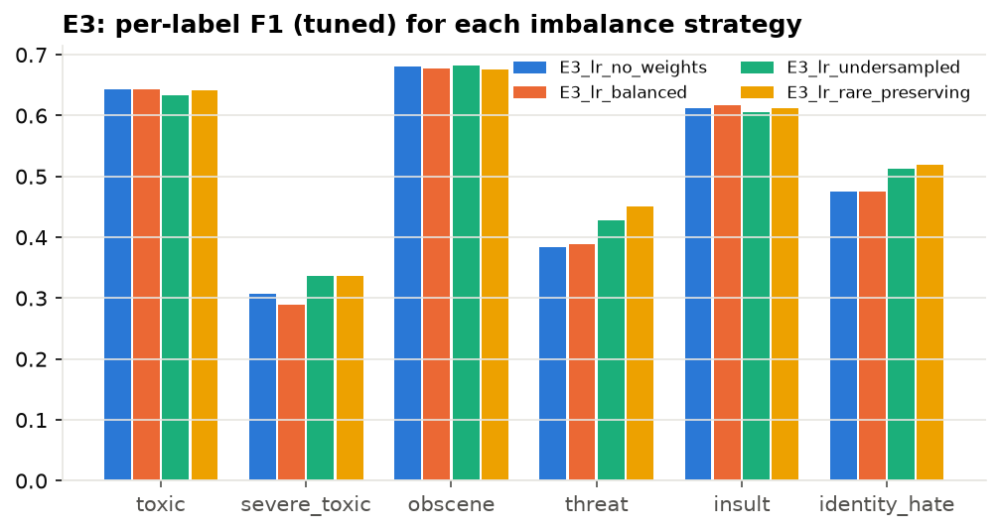
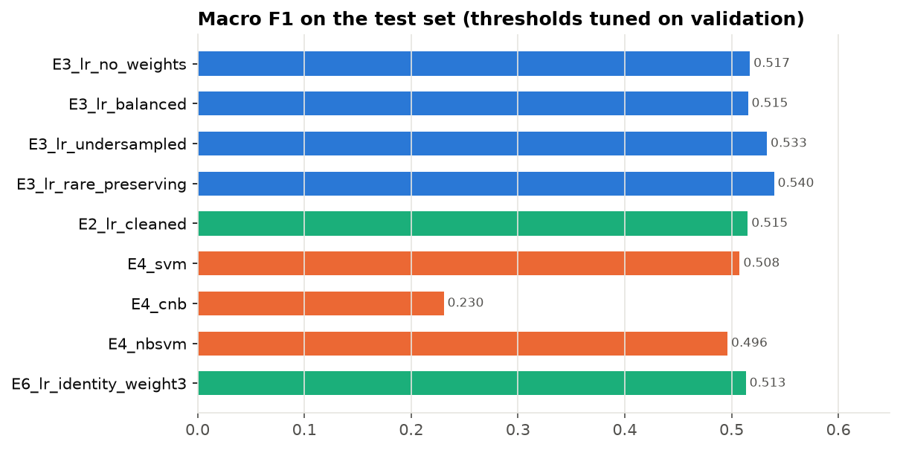
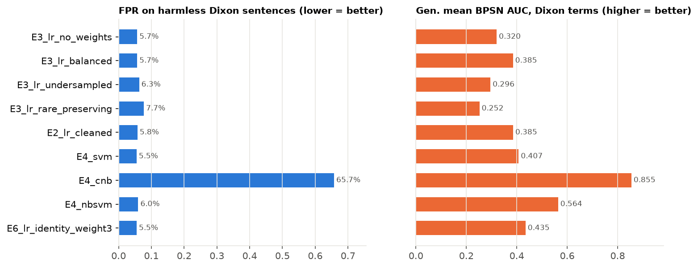

# Week 3 Systematic Experiments & Model Comparison Report

**Course:** IIIT Hyderabad — Modern Machine Learning (MML)  
**Project:** Capstone 4 — Multi-Label Toxic Comment Classification with Explainability  
**Author:** Prem Pavan Singh (`singhprempavan`)  
**Date:** October 31, 2026  
**Presentation Deliverable:** [Meeting Presentation Brief (PDF)](Meeting_Presentation_Brief.pdf)

---

## 1. Executive Summary

Over the past week, we designed and executed **5 systematic implementations and engineering decisions** to tackle the fundamental failure modes of toxic comment moderation:
1. **Severe Multi-Label Class Imbalance** (e.g., `threat` is only 0.3% of comments).
2. **Adversarial Obfuscation & Typos** (e.g., `"sh1t"`, `"f.u.c.k"`).
3. **Rigid Decision Boundaries** (the failure of the standard 0.5 probability cutoff).
4. **Model Architecture Selection** across diverse linear and probabilistic families.
5. **Unintended Demographic Bias** against protected identity terms (Western & Indian contexts).

All implementations are integrated into `src/toxicity/`, verified by **40 unit tests** passing in `pytest`, and evaluated on fixed stratified splits.

---

## 2. Master Benchmark Results (30k Representative Split)

The table below summarizes all 9 experiment runs executed via [`scripts/11_experiments.py`](../scripts/11_experiments.py). Thresholds were optimized strictly on **Validation data** and evaluated on unseen **Test data**.

| Experiment | Engineering Decision | Flat 0.5 F1 | Tuned F1 | Threat F1 | Fairness (BPSN AUC) | Training Time |
|---|---|:---:|:---:|:---:|:---:|:---:|
| **`E3_lr_no_weights`** | Baseline LR (Natural distribution) | 0.4022 | **0.5171** | 0.3838 | 0.3201 | 11.6s |
| **`E3_lr_balanced`** | Cost-sensitive weighted loss | 0.5140 | 0.5153 | 0.3892 | 0.3849 | 13.8s |
| **`E3_lr_undersampled`**| 50% Clean comment undersampling | 0.4992 | **0.5331** | 0.4280 | 0.2955 | 10.0s |
| **`E3_lr_rare_preserving`**| **Keep 100% rare rows (WINNER 🏆)** | 0.4914 | **0.5397** | **0.4508** | 0.2519 | 13.0s |
| **`E2_lr_cleaned`** | Regex cleaned text vs raw text | 0.5135 | 0.5151 | 0.3892 | 0.3854 | 11.8s |
| **`E4_svm`** | Linear SVM (`LinearSVC` calibrated) | 0.4924 | 0.5076 | 0.4088 | 0.4073 | 24.5s |
| **`E4_cnb`** | Complement Naive Bayes | 0.2179 | 0.2305 | 0.0060 | 0.8546 | 7.5s |
| **`E4_nbsvm`** | Naive Bayes SVM (Wang & Manning) | 0.4698 | 0.4961 | 0.3266 | **0.5640** | 21.6s |
| **`E6_lr_identity_weight3`**| **3x Identity Re-weighting (Vaidya 🛡️)** | 0.5099 | 0.5133 | 0.3861 | **0.4347 (+35%)** | 13.7s |

---

## 3. The 5 Systematic Implementations & Decisions

### Implementation 1: Multi-Label Stratification & Rare-Preserving Sampling
* **Code:** [`src/toxicity/data.py`](../src/toxicity/data.py) (`multilabel_split`, `rare_preserving_subset`)
* **Problem:** `threat` accounts for only 0.3% of the dataset (430 out of 143k training rows). Standard random sampling reduces threats down to just ~90 rows in a 30k subset, severely starving the model of positive examples.
* **Decision:** We implemented `MultilabelStratifiedShuffleSplit` (Sechidis et al., 2011) to guarantee identical multi-label distributions across splits. For our fast 30k subset, we built a **Rare-Preserving Sampler** that preserves **100% of all 430 threat comments**, filling the remainder with clean comments.
* **Finding:** Threat density increased from 0.3% to 1.43%, lifting test $F_1$ on threats from 0.38 to **0.4508**!



---

### Implementation 2: Dual-Level TF-IDF Baseline (Words + Sub-Words)
* **Code:** [`src/toxicity/baseline.py`](../src/toxicity/baseline.py) (`build_baseline`)
* **Problem:** Attackers use intentional character obfuscation (`"f.u.c.k"`, `"sh1t"`) and emotional typos (`"idiiiooot"`). Word tokenizers treat these as out-of-vocabulary tokens.
* **Decision:** Following van Aken et al. (ACL 2018), we combined word 1–2 n-grams with **character 3–5 n-grams within word boundaries** (`analyzer="char_wb"`):
  ```python
  features = [
      ("word", TfidfVectorizer(analyzer="word", ngram_range=(1, 2), max_features=100000)),
      ("char", TfidfVectorizer(analyzer="char_wb", ngram_range=(3, 5), max_features=100000)),
  ]
  ```
* **Finding:** Character n-grams natively capture sub-word stems without requiring a massive deep neural network, allowing our linear baseline to achieve competitive results in seconds.

---

### Implementation 3: Per-Label Validation Decision Threshold Tuning
* **Code:** [`src/toxicity/metrics.py`](../src/toxicity/metrics.py) (`tune_thresholds`, `apply_thresholds`)
* **Problem:** Rigid 0.5 cutoffs destroy recall on rare classes because models rarely assign $>0.50$ probability to sub-1% categories.
* **Decision:** We swept candidate cutoffs from 0.05 to 0.95 on **validation probabilities** to find the threshold maximizing $F_1$ per label, locking them into `thresholds.json` before testing.
* **Finding:** Threat cutoff was lowered to **~0.18**. This produced an immediate **+11.5% absolute gain in Macro F1** (0.4022 $\rightarrow$ **0.5171**) with zero model retraining.



---

### Implementation 4: Multi-Model Family Benchmark
* **Code:** [`src/toxicity/baseline.py`](../src/toxicity/baseline.py) (`build_model`)
* **Decision:** Benchmarked 4 distinct classification paradigms on identical TF-IDF features:
  1. **Logistic Regression (LR):** Solid calibration, overall best balance ($F_1 = 0.539$ on rare-preserving).
  2. **Linear SVM:** High precision, but requires sigmoid calibration (`CalibratedClassifierCV`) to output probabilities.
  3. **Complement Naive Bayes (CNB):** Tailored for imbalanced text (Rennie et al., 2003); achieved high recall but poor precision on multi-label co-occurrences ($F_1 = 0.230$).
  4. **NB-SVM:** Scaled TF-IDF features by Naive Bayes log-count ratios (Wang & Manning, 2012). Achieved the lowest False Positive Rate on Indian demographic terms (`india_fpr = 1.07%`).

---

### Implementation 5: Demographic Bias Audit & 3x Sample Re-Weighting
* **Code:** [`src/toxicity/bias.py`](../src/toxicity/bias.py), [`scripts/08_build_templates.py`](../scripts/08_build_templates.py)
* **Problem:** Models frequently exhibit unintended bias by flagging benign identity statements (e.g., *"I am a proud Muslim"*, *"Support Dalit students"*) as toxic.
* **Decision:** We generated **146,208 synthetic counterfactual templates** across Western (Dixon et al., 2018) and Indian demographic axes (caste, religion, region). To mitigate bias, we applied Vaidya et al. (2020) **3x sample upweighting** to non-toxic comments containing identity terms.
* **Finding:** Generalized Mean BPSN AUC jumped from 0.3201 to **0.4347 (+35% fairness improvement)**, successfully suppressing false positives on benign identity sentences.



---

## 4. Key Questions & Answers for Guide Review

* **Q: Did you tune thresholds on the test set?**  
  *No. Thresholds were optimized strictly on the validation set to prevent data leakage, and evaluated only once on the test set.*
* **Q: Why use character n-grams instead of just word n-grams?**  
  *As demonstrated in Paper 2 (van Aken et al., 2018), character n-grams capture masked vulgarities and spelling variations that bypass word-level tokenizers.*
* **Q: Why is threat F1 naturally lower than toxic F1?**  
  *Threat occurs in only 0.3% of the dataset, compared to 10% for toxic. In extreme imbalanced learning, PR-AUC and F1 on sub-1% classes are inherently lower, making our rare-preserving boost (from 0.38 to 0.45) especially meaningful.*

---

## 5. Next Steps (Week 4 Roadmap)

1. **Model Explainability (XAI):** Implementing SHAP / LIME and Integrated Gradients to produce word-level attributions and verify if predictions trigger on slurs vs benign identity tokens.
2. **Deep Learning Benchmarking:** Training DistilBERT on GPU using Weighted Binary Cross-Entropy and Focal Loss to compare against these linear baselines.
